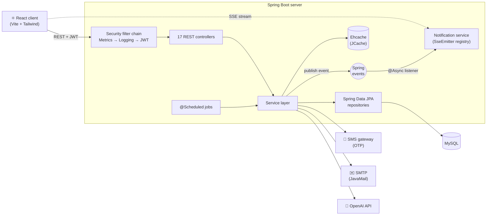
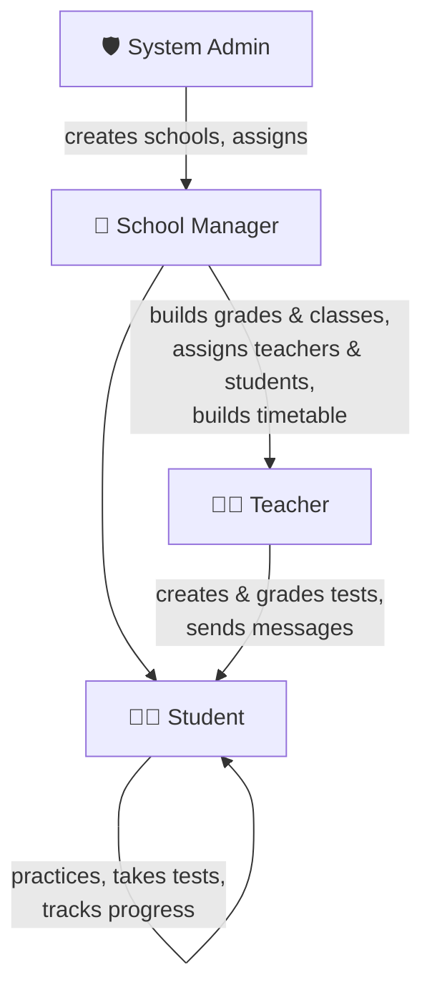

<div align="center">

# 🎓 Learning Platform — Server

**A multi-tenant school management & adaptive math-practice platform, built with Spring Boot.**

REST API · JWT + SMS 2FA · Real-time notifications (SSE) · AI tutor · Auto-generated math exercises

[](https://openjdk.org/)
[](https://spring.io/projects/spring-boot)
[](https://spring.io/projects/spring-security)
[](https://www.mysql.com/)
[](./Dockerfile)
[](#-api-documentation)
[](https://learning-project-server.onrender.com)

[**Live app**](https://schoolmanagmentsystem-z0m5.onrender.com) · [**Frontend**](../frontend) · [**API docs**](#-api-documentation)

</div>

---

## 📌 Overview

The backend of a full-stack platform that runs a school's day-to-day work in one place. A system admin onboards schools, school managers build their school (grades, classes, teachers, timetable), teachers create and assign tests, and students practice math with **unlimited auto-generated questions**, take timed tests and track their progress.

The server exposes **~60 REST endpoints** across 17 controllers, persists **24 JPA entities** in MySQL, and pushes live updates to users over **Server-Sent Events**.

## ✨ Key Features

| Area | What it does |
|---|---|
| 🔐 **Authentication** | Registration, login, **two-factor authentication via SMS one-time codes** (2-minute expiry), password reset by OTP, stateless **JWT** sessions, salted SHA-256 password hashing |
| 🏫 **School management** | Schools → grades → classrooms → students; assign/remove teachers, teaching subjects and managers; weekly timetable per class, teacher and student |
| 🧮 **Question engine** | **31 parameterized question generators** across 9 topics — integers, fractions, equations (incl. quadratic & 2×2 systems), complex numbers, vectors, matrices, analytic geometry, derivatives & integrals, and Hebrew word problems |
| 📝 **Tests** | Students generate self-practice tests (subject, topic, difficulty, length, time limit); teachers generate tests for whole classes and the server grades them automatically |
| 📊 **Progress tracking** | Per-student statistics and question history by subject and topic |
| 💬 **Messaging** | Targeted broadcast messages — to a class, a grade, all students, all teachers, teachers of a grade or all managers |
| 🔔 **Real-time notifications** | Event-driven: domain events → async listener → **SSE** push to connected clients |
| 🤖 **AI tutor** | ChatGPT integration with per-user conversation memory |
| 📅 **Upcoming events** | Role-aware dashboard feed (next lessons, tests, school events) |
| ⏰ **Background jobs** | Scheduled re-engagement emails to inactive users, session cleanup, keep-alive self-ping for the free hosting tier |

## 🏗️ Architecture



### Design patterns in the codebase

- **Factory** — `MathQuestionFactory` picks the right generator for a subject/topic; `UserMapperFactory` builds role-specific views of a user; `MessageRecipientStrategyFactory` resolves who receives a message.
- **Strategy** — message recipients (`ClassRecipientStrategy`, `GradeRecipientStrategy`, `AllTeachersStrategy`, …) and role-based upcoming events (`StudentEventStrategy`, `TeacherEventStrategy`, …) are interchangeable strategies.
- **Observer / event-driven** — services publish `NotificationEvent`s through `ApplicationEventPublisher`; an `@Async @EventListener` fans them out over SSE, keeping business logic decoupled from delivery.
- **Mapper layer** — a generic `Mapper<I, O>` interface with ~18 dedicated entity → DTO mappers, so entities never leak out of the API.
- **Layered architecture** — controller → service → repository, with DTOs, response objects, projections and constants in their own packages.

### Performance

- **Second-level caching** with Ehcache on hot reads — schedules, test status, schools, received messages, upcoming events.
- **Hibernate JDBC batching** (`batch_size=50`, ordered inserts/updates) for bulk operations such as generating a whole class's timetable.
- **Async processing** for SMS, email and AI calls so requests are never blocked by third-party latency.

## 🛠️ Tech Stack

| Layer | Technologies |
|---|---|
| Language & framework | Java 17, Spring Boot 3.4 (Web, Data JPA, Security, Cache) |
| Persistence | MySQL, Hibernate, Spring Data JPA projections |
| Security | Spring Security (stateless), JJWT, SMS OTP two-factor auth |
| Caching | Ehcache 3 via JCache |
| Integrations | OpenAI Chat Completions, SMS gateway, JavaMail (SMTP) |
| Docs & tooling | springdoc-openapi (Swagger UI), Lombok, JavaFaker, Maven |
| DevOps | Multi-stage Docker build, Spring profiles (`dev` / `production`), Render |

## 📁 Project Structure

```
src/main/java/org/example/learningprojectserver
├── config/          # Spring Security, CORS, caching & async setup
├── controller/      # 17 REST controllers
├── service/         # Business logic
│   └── MathQuestion/   # 31 question generators in 9 topic packages
├── entities/        # 24 JPA entities
├── repository/      # Spring Data repositories
├── dto/ response/   # API contracts
├── mappers/         # Entity → DTO mappers
├── strategy/        # Message-recipient & upcoming-event strategies
├── notification/    # Events, publisher, async listener, SSE DTOs
├── filter/          # JWT, logging and metrics filters
├── jobs/            # Scheduled jobs
└── utils/           # JWT, SMS, email, OpenAI client, generators
```

## 🚀 Getting Started

### Prerequisites
- Java 17+
- MySQL 8
- Maven (or the bundled `./mvnw`)

### Environment variables

| Variable | Purpose |
|---|---|
| `DB_URL`, `DB_USERNAME`, `DB_PASSWORD` | MySQL connection (production profile) |
| `GPT_TOKEN` | OpenAI API key for the AI tutor |
| `SMS_TOKEN` | SMS gateway credentials for OTP codes |

A `.env` file in the project root is picked up automatically (`spring-dotenv`).

### Run locally

```bash
git clone https://github.com/shaiberkov/learning-platform.git
cd learning-platform/backend
./mvnw spring-boot:run -Dspring-boot.run.profiles=dev
```

The API starts on `http://localhost:8080`.

### Run with Docker

```bash
docker build -t learning-server .
docker run -p 8080:8080 --env-file .env learning-server
```

## 📖 API Documentation

Interactive OpenAPI docs are generated automatically:

- **Swagger UI:** `/swagger-ui.html`
- **OpenAPI spec:** `/v3/api-docs`

<details>
<summary><b>Endpoint overview</b> (click to expand)</summary>

| Resource | Example endpoints |
|---|---|
| `/user` | `add-user`, `login`, `send-otp`, `verify-otp`, `forgot-password`, `reset-password` |
| `/system-admin` | `add-new-school-to-system`, `assign-school-manager-to-school`, `get-all-schools` |
| `/school-manager` | `add-school-grades`, `add-classes-to-grade`, `assign-teacher-to-classes`, `assign-student-to-class`, `add-lesson-to-teacher`, `get-schedule-for-classroom` … (23 endpoints) |
| `/teacher` | `schedule-for-teacher`, `generate-test-for-students`, `check-teacher-test` |
| `/student` | `generate-question`, `submit-answer`, `generate-practice-test`, `check-practice-test`, `start-test`, `get-student-tests-status` |
| `/message` | `recipient-types`, `send-message`, `get-all-recived-messages` |
| `/notifications` | `connect` (SSE stream) |
| `/Chat` | `get-response-from-chatGpt-with-memory`, `clear-conversation` |
| `/upcoming-events`, `/User-Statistic`, `/validate-token`, `/ping` | dashboard data, statistics, session validation, health check |

</details>

## 👥 User Roles



## 👤 Author

**Shai Berkovich** — B.Sc. Computer Science
[GitHub](https://github.com/shaiberkov)
