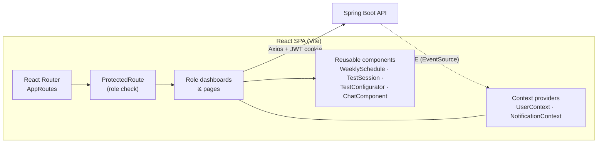

<div align="center">


# 🏫 School Management & Learning System — Client

**One web app for the whole school: admins, managers, teachers and students, each with their own dashboard.**

Role-based dashboards · Timetables · Unlimited math practice · Timed tests · Live notifications · AI tutor

[](https://react.dev/)
[](https://vitejs.dev/)
[](https://tailwindcss.com/)
[](https://reactrouter.com/)
[](https://axios-http.com/)
[](https://schoolmanagmentsystem-z0m5.onrender.com)

### [🌐 Live demo](https://schoolmanagmentsystem-z0m5.onrender.com) · [⚙️ Backend](../backend)

</div>

> [!NOTE]
> The app is hosted on Render's free tier, so the first request may take ~30 seconds while the server wakes up.

---

## 📌 Overview

The front end of a full-stack platform for running a school and helping its students practice. It talks to a [Spring Boot REST API](../backend) and gives each of the four user roles its own dashboard, sidebar and set of pages. The interface is in Hebrew and fully **right-to-left**.

## ✨ Features by Role

<table>
<tr>
<td width="50%" valign="top">

### 🛡️ System Admin
- Register new schools in the system
- Assign and remove school managers
- Send broadcast messages

### 🏫 School Manager
- Build the school: add/remove grades, classes per grade
- Assign teachers to the school and to classes
- Manage each teacher's teaching subjects
- Assign students to classes
- Create lessons and view **weekly timetables per class**

</td>
<td width="50%" valign="top">

### 👩‍🏫 Teacher
- Personal weekly timetable
- **Test configurator** — subject, topic, difficulty, question count and time limit, sent to a whole class
- Messaging to classes and grades

### 🧑‍🎓 Student
- Personal weekly timetable
- **Unlimited practice** — pick a subject → topic → exercise, get instant feedback
- Self-generated practice tests and **timed teacher tests** with a live countdown
- Tests table with status and results
- **AI tutor chat** for help with exercises

</td>
</tr>
</table>

### Shared across roles
- 🔐 Login, registration, **SMS two-factor authentication** and password reset
- 🔔 **Real-time notifications** over Server-Sent Events (new tests, messages)
- 📅 Upcoming-events feed on every dashboard
- 🚧 Protected routes — pages are only reachable by the roles allowed to see them

## 🏗️ Architecture



### Highlights

- **Role-based routing** — a `ProtectedRoute` wrapper checks the logged-in user's role before rendering any page, and public-only routes keep logged-in users out of login/register screens.
- **Global state with Context API** — `UserContext` holds the session; `NotificationContext` keeps an `EventSource` connection open and pushes live notifications into the UI.
- **Timed test engine** — `TestSession` drives a full exam flow: question navigation, answer state, countdown timer and submission for automatic grading.
- **Centralized constants** — routes, API endpoints, messages, styles and assets live in dedicated `constants/` modules instead of being hard-coded through the app.
- **Cookie-based session** with `universal-cookie`, and a JWT sent with every API call.

## 🛠️ Tech Stack

| Category | Technologies |
|---|---|
| Core | React 19, Vite 6, JavaScript (ES2022) |
| Routing | React Router 7 |
| Styling | Tailwind CSS 4, DaisyUI, Lucide & React Icons |
| Data | Axios, Server-Sent Events |
| UI components | React Select, React Datepicker, React Modal |
| Dates | date-fns, Day.js |
| Quality | ESLint 9 (React Hooks rules) |

## 📁 Project Structure

```
src/
├── routes/        # AppRoutes — every route and its allowed roles
├── features/auth/ # Login, Register, TwoFactorAuthForm, ResetPassword
├── pages/
│   ├── admin/     # System-admin screens
│   ├── manager/   # School-manager screens (grades, classes, teachers, lessons)
│   ├── teacher/   # Teacher dashboard & timetable
│   ├── student/   # Dashboard, practice, tests table, timetable
│   └── footer/    # About, FAQ, Privacy policy, Terms
├── components/    # SideBar, WeeklySchedule, TestSession, TestConfigurator,
│                  # ChatComponent, ProtectedRoute, messages/ …
├── context/       # UserContext, NotificationContext (SSE)
└── constants/     # Routes, API, messages, styles, assets
```

## 🚀 Getting Started

```bash
git clone https://github.com/shaiberkov/learning-platform.git
cd learning-platform/frontend
npm install
npm run dev
```

The app runs on `http://localhost:5173`.

By default it calls the deployed API. To work against a local server, set `API_BASE_URL` in `src/constants/base.constants.js` to `http://localhost:8080` and start the [backend](../backend).

| Script | Description |
|---|---|
| `npm run dev` | Start the dev server with hot reload |
| `npm run build` | Production build into `dist/` |
| `npm run preview` | Preview the production build |
| `npm run lint` | Run ESLint |

## 👤 Author

**Shai Berkovich** — B.Sc. Computer Science
[GitHub](https://github.com/shaiberkov)
